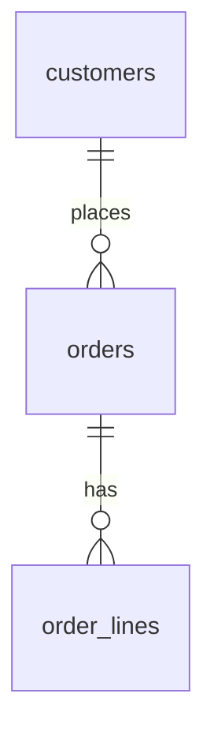

# DB doc templates

Templates: the index (`docs/database/README.md`), a domain file
(`docs/database/<domain>.md`), and the local, git-ignored record of decisions
and open questions, in one of two places depending on the profile:

- default: the questions file (`docs.db_questions`, e.g.
  `docs/plans/database.md`), with answered questions moving to the domain
  doc's **Design decisions** table;
- feature `db_questions_in_be_plan`: a "DB design" section in the owning
  module's BE plan; the domain doc then has no Design decisions or Not ported
  sections and cites no decision ids.

Drop sections that don't apply; don't leave placeholders in committed docs.
Use the project's id type, enum location and precision in the examples' place.

---

## Index: `docs/database/README.md`

````markdown
# Database

PostgreSQL schema for <project title>. This file is the index; each domain
has its own file under this folder. The design is produced by the `db-design`
skill and reviewed by an independent reviewer; entities must match it.

- **Updated:** YYYY-MM-DD
- **Status:** N tables implemented, N designed, N provisional

## Sources used

The design was built on these versions. The `db-design` skill asks whether
they are still the latest before every run.

| Source            | Version / date              | Confirmed latest on |
| ----------------- | --------------------------- | ------------------- |
| SOW               | <title, v1.0, date> \| none | YYYY-MM-DD          |
| BA: `<module>.md` | <Source: line>              | YYYY-MM-DD          |
| Client decisions  | Slack thread YYYY-MM-DD     | YYYY-MM-DD          |
| Lovable prototype | HEAD <commit sha>           | YYYY-MM-DD          |

## Conventions

Ids, timestamps, soft delete, enums as varchar (and where they are defined),
money and percentage precision, FK and `ON DELETE` rules, time zone and
business-day keys, snapshots, sensitive data, document numbers. Short
bullets; link to `CLAUDE.md` for the rest.

## Schema sync / migrations

How the schema reaches each environment (migrations and drift check, or
`synchronize` on dev until a cutover). Keep this accurate when it changes.

## Domains

| Domain | File                       | Scope tag | Tables |
| ------ | -------------------------- | --------- | ------ |
| <Name> | [<domain>.md](<domain>.md) | SOW       | 8      |

## Overall ERD



## Table index

| Table         | Domain   | Status                                   | Scope tag        |
| ------------- | -------- | ---------------------------------------- | ---------------- |
| `customers`   | customers| Implemented (<migration> \| entity)      | SOW              |
| `orders`      | orders   | Designed                                 | BA               |
| `internal_x`  | parts    | Provisional (DB-Q12) \| Provisional      | Client-requested |

## Design changelog <!-- default mode only; plan mode keeps it in the plan -->

| Date       | Change                        |
| ---------- | ----------------------------- |
| YYYY-MM-DD | Initial design of N domains   |
````

---

## Domain file: `docs/database/<domain>.md`

````markdown
# <Domain> schema

- **Module(s):** <module keys>, BA doc `docs/user-stories/<module>.md`
- **Scope tag:** SOW (page) | SOW (BA only: story) | BA (story) | Client-requested (date, source) | Pending scope
- **Updated:** YYYY-MM-DD

## Purpose

Two or three sentences on what this domain records and who writes it.

## ERD

```mermaid
erDiagram
  orders {
    <id type> id PK
    varchar number UK
    <id type> customer_id FK
    varchar status
  }
  orders ||--o{ order_lines : has
```

## Tables

### `orders`

What one row is. Status: Designed | Implemented (…) `<entity file>`.
Scope tag: SOW. Delete policy: soft delete | never deleted | hard delete
(source). Concurrency: `version` column | row lock in <service> | none (why).
Volume and retention (growing tables only): ~N rows/year, kept for … (reason).

| Column        | Type          | Null | Default | Constraints / FK  | Meaning and source    |
| ------------- | ------------- | ---- | ------- | ----------------- | --------------------- |
| `id`          | <id type>     | no   |         | PK                |                       |
| `number`      | varchar(20)   | no   | seq     | UNIQUE (partial)  | `SO-#####` (BA US01)  |
| `customer_id` | <id type>     | no   |         | FK → customers.id |                       |
| `status`      | varchar(30)   | no   | DRAFT   | `OrderStatus`     | Stored; rules below   |
| `total`       | numeric(14,2) | no   | 0       | ck >= 0           | Line totals + charges |
| `created_at`  | timestamp     | no   | now()   |                   |                       |

**Indexes:** `(status, created_at)`, `(customer_id)` … and why (which
filter/sort they serve). Unique keys on soft-deleted tables are partial:
`UNIQUE (number) WHERE deleted_at IS NULL`.

**Checks:** `ck_orders_total CHECK (total >= 0)` … (none on enum columns;
they are validated in the app).

**Derived, not stored:** values computed on read, with the formula and source.

**Differs from the entity** (Implemented tables only): what the entity has
that the design changes, each marked additive or breaking.

## Enums

`OrderStatus` (<enum file>): `DRAFT`, `CONFIRMED`, … with one line per value
when the meaning isn't obvious, and the source.

## Business rules enforced by the schema

Unique keys, check constraints, required-together columns, snapshots, and
which rules are left to the service layer (state machine guards,
permissions), each with its source.

## Status machines

States, allowed transitions, guards, who or what triggers each transition,
whether it's stored or derived.

## Cross-domain links

FKs into and out of this domain, and the effects on other domains (e.g.
paying an invoice closes the work order; shipping an order writes inventory
movements).

## Not ported from Lovable <!-- default mode only -->

Prototype mechanics and bugs deliberately left out, one line each.

## Design decisions <!-- default mode only -->

`Decided by` is `user`, `client` or `designer`. The reviewer treats `user`
and `client` rows as settled; `designer` rows stay open to challenge.

| Id  | Decision | Date | Decided by |
| --- | -------- | ---- | ---------- |
````

---

## Default mode: questions file (git-ignored, never committed)

```markdown
# Database: open questions

- **Updated:** YYYY-MM-DD
- Answered questions move to the **Design decisions** table of their domain
  file in `docs/database/` and are removed from here.

## Index

| Id     | Domain   | Tag      | Question (one line)                 |
| ------ | -------- | -------- | ----------------------------------- |
| DB-Q01 | <domain> | [Client] | Are invoice-driven statuses stored? |

## <domain>

**DB-Qnn [Client|BA|Tech] Title.** Context with sources, options,
recommendation and why. Affects: the columns and tables marked
`Provisional (DB-Qnn)`.
```

---

## Plan mode: section in `docs/plans/<module>.be.md` (git-ignored)

Added to the BE plan of the module that owns the domain, before "Risks and
dependencies". Kept across plan rewrites; rows are never dropped.

```markdown
## DB design

Domain doc: `docs/database/<domain>.md`. The reviewer treats `user` /
`client` rows as settled; `designer` rows stay open to challenge.

### DB design decisions

| Id         | Decision | Date | Decided by |
| ---------- | -------- | ---- | ---------- |
| D-<DOM>-01 |          |      | user       |

### Not ported from Lovable (DB)

Prototype mechanics and bugs deliberately left out, one line each.

### DB open questions

`DB-Qnn` **[Client|BA|Tech]** context with sources, options,
recommendation, and the tables / columns it affects (marked `Provisional` in
the domain doc). Ids are stable and never reused; an answered question moves
to DB design decisions.

### DB design changelog

| Date       | Change                                      |
| ---------- | ------------------------------------------- |
| YYYY-MM-DD | Initial design / documentation of N domains |
```
